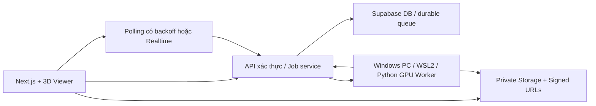

# Fitmatch 3D — kế hoạch nâng cấp chức năng và UI/UX

Ngày: 04/11/2026. Trạng thái: kế hoạch sản phẩm và triển khai theo yêu cầu đã phỏng vấn; engine AI và hiệu năng chờ technical spike. Chưa triển khai app, chưa chạy model trên RTX 3060.

Nguồn yêu cầu: [3d-upgrade-discovery.md](./3d-upgrade-discovery.md).
Nguồn nghiên cứu: [RESEARCH.md](./3d-research.md).
Các bản clone, commit và metadata: [repository-manifest.json](./3d-repository-manifest.json).

## 1. Kết quả sản phẩm

Người dùng chụp ảnh cơ thể, tạo avatar cá nhân chân thực, số hóa áo thun/sơ mi của chính họ từ ảnh trước/sau, rồi chọn áo đã sẵn sàng để mặc lên avatar 3D và xoay xem gần như tức thì. Bản đầu dùng cho nghiên cứu/nhóm nhỏ trên desktop, tận dụng PC Windows RTX 3060 12 GB.

Điểm quyết định: không chạy toàn bộ AI khi bấm chọn áo. Avatar, garment và bản drape được xử lý nền trước. Viewer sử dụng mesh/texture có cache. Phải phân biệt rõ lần chuẩn bị dài với lần chọn áo nhanh.

Độ chân thực là mục tiêu chất lượng; chưa coi một mesh đẹp nhưng sai dáng, đổi màu/logo hoặc chỉ là một khối người mặc đồ liền là hoàn thành.

## 2. Baseline đã đọc trong app

- Next.js App Router, React/TypeScript, Supabase Auth/DB/private Storage; các trang landing, wardrobe, outfits, quiz, login.
- Wardrobe lưu ảnh và metadata; chưa có multi-view garment asset, avatar hay prepared fitting.
- Outfit suggestions và ảnh lookbook hiện đi từ mô tả, không phải phép thay đúng áo lên avatar cụ thể.
- Giao diện nguồn hiện dùng nền tối, màu cam đất, Archivo/Geist; navbar Outfits/Wardrobe/Style Quiz. Đánh giá UI lần này dựa code, chưa xác nhận bằng browser screenshot.
- Có audit và brief sửa lỗi trước đó. Audit có baseline/branch khác nhau; phải đối chiếu HEAD khi triển khai, không coi các phát hiện cũ còn nguyên hoặc đã được sửa.
- Đã đọc hướng dẫn Route Handlers trong `node_modules/next/dist/docs/`; implementation phải tiếp tục đọc đúng hướng dẫn Next được cài trước từng phần sửa.
- Các file untracked đang có trong checkout được giữ nguyên. Research không thay source app và không tải migration production.

## 3. Phạm vi bản đầu và mở rộng

| Bản đầu bắt buộc | Mở rộng sau |
|---|---|
| Tạo/lưu avatar từ ảnh, hình dáng cá nhân, có texture | Avatar chuyển động, biểu cảm, pose tự do |
| Avatar 3D xoay, zoom, front/side/back | AR, video try-on, mobile scan nâng cao |
| Áo thun và sơ mi cơ bản từ ảnh trước/sau | Hoodie, jacket, quần, váy, giày |
| Giữ màu, logo, kiểu cổ/tay/form; kiểm tra bằng áo thật | Cam kết fit/size, pressure/strain maps |
| Chọn áo đã chuẩn bị gần tức thì | Solver vải live khi kéo/chuyển động |
| Lưu outfit, so sánh hai look, gợi ý từ wardrobe | Layering nhiều áo và thương mại hóa |
| Trạng thái nền, lỗi, retry và quản trị worker | Nhiều worker, hàng đợi trả phí/SLA |

Một áo tại một thời điểm, avatar tư thế A-pose nhẹ cố định khi drape. Viewer xoay camera quanh người; chưa cần đổi pose. Quần nền trung tính chỉ phục vụ che phủ nếu chưa hỗ trợ quần cá nhân; không giới thiệu là quần từ wardrobe.

## 4. Pipeline 3D và quyết định engine

### Avatar

Capture có hướng dẫn → kiểm tra ảnh và người → estimate cơ thể tham số → đối chiếu ảnh/số đo → dựng body dùng cho collision → tạo appearance/texture → kiểm tra → đóng gói avatar web có version.

- Đề xuất ảnh trước, bên, sau trong tư thế thống nhất; chiều cao bắt buộc, ảnh mặt tùy chọn cho độ giống. Không yêu cầu ảnh khỏa thân; hướng dẫn quần áo ôm vừa để giảm che khuất silhouette.
- Body fitting và appearance tách riêng: áo đang mặc trong ảnh không trở thành phần cơ thể dùng để mặc áo mới.
- Bắt đầu benchmark ECON/SiTH để hiểu chất lượng shape/texture; không coi một trong hai tự động cung cấp body sạch, rig và phép thay áo.
- Chọn body model phải có quyền sử dụng phù hợp; code MIT không tự cấp quyền SMPL-X/checkpoint.
- Multi-view fusion và face likeness là công việc riêng; các đầu vào bổ sung không tự động được repo single-image sử dụng.
- Nếu không đạt độ giống hoặc không chạy được trong phần cứng, trình bày kết quả spike và lựa chọn thực tế; không âm thầm đổi thành mannequin chung.

### Trang phục

Ảnh trước/sau/chi tiết → mask và căn chỉnh → xác định loại/cấu trúc → pattern/template hoặc reconstruction → kiểm tra topology/seams → gán UV và texture → kiểm tra màu/logo → garment canonical có version.

- GarmentCode là ứng viên nền tảng template/pattern và mô phỏng có kiểm soát.
- ChatGarment là ứng viên ảnh → pattern; script 7B bf16 cần port/giảm bộ nhớ mới có thể thử trên 12 GB. Chưa hứa quantization giữ chất lượng.
- ReWeaver là nhánh benchmark cho ảnh nhiều góc, cần adapter ảnh thực và chuyển output `.npz` thành asset dùng được.
- SewFormer dùng làm baseline; simulator Maya/Qualoth không chọn mặc định.
- Giữ logo/họa tiết cần module texture transfer/projection riêng. Pattern đúng không đồng nghĩa texture đúng. Các vùng không có ảnh không thể cam kết giống đồ thật.
- Cho chỉnh các thông tin có ý nghĩa: áo thun/sơ mi, tay, cổ, regular/oversize, nút và màu. Không bắt người dùng chỉnh lưới 3D.
- Nếu cần kích thước thực, xin số đo áo hoặc vật chuẩn; ảnh và nhãn S/M/L không đủ tự xác định chính xác.

### Chuẩn bị mặc áo

Garment version + avatar version → thống nhất scale/hệ trục → bố trí ban đầu → drape/retarget → kiểm tra xuyên body → texture/LOD → GLB + thumbnail → `ready`.

- Giữ nguyên kích thước chiếc áo; không sửa rập theo từng body như đồ may đo nếu không có thao tác rõ ràng.
- Tạo prepared asset khi thêm áo hoặc hoàn tất avatar; một prepared mesh gắn đúng cặp avatar/garment và version pipeline.
- Cache key: avatar version + garment version + material version + pose + engine version.
- Thay ảnh avatar/áo tạo version mới và invalidation, không trả prepared asset cũ như kết quả mới.
- VTON360 là nhánh R&D 360 bổ sung. 3DGS không được coi là mesh GLB riêng body/áo; chọn nhánh này phải đổi viewer và tiêu chí tương ứng một cách công khai.

## 5. Chọn áo gần tức thì

1. Sau upload, UI cho xem ảnh áo ngay và trạng thái dựng 3D.
2. Khi garment và fitting của avatar hiện tại sẵn sàng, xuất asset đã nén, tải thumbnail và preload áo có khả năng chọn tiếp.
3. Bấm áo đã preload: đổi mesh trong viewer, giữ body/camera/ánh sáng. Không gọi diffusion, reconstruction hoặc solver nặng.
4. Bấm áo chưa tải: hiển thị trạng thái tải trên chính card; giữ outfit hiện tại cho đến khi asset mới kiểm tra xong.
5. Áo chưa xử lý xong vẫn xuất hiện trong wardrobe, có nhãn rõ và nút theo dõi tác vụ; không hứa đổi ngay và không giấu thời gian dựng.
6. Khi avatar đổi, cảnh báo các áo cần chuẩn bị lại; vẫn cho xem các look cũ với avatar version cũ.

Mục tiêu nghiệm thu đề xuất: warm switch p95 ≤ 1 giây, cold switch p95 ≤ 3 giây trên môi trường benchmark; viewer ≥ 30 FPS. Ghi riêng network download, decode và render. Các con số này là mục tiêu, chưa đo được.

## 6. Chức năng của bản nâng cấp

| Module | Chức năng và hành vi |
|---|---|
| My Avatar | Capture wizard, upload, chất lượng ảnh, tạo nền, preview, chọn active version, sửa đầu vào, xóa |
| Wardrobe | Ảnh trước/sau/chi tiết, metadata, category/filter/favorite, 3D status, preview áo, tạo lại theo version |
| Fitting Studio | Avatar trung tâm, chọn áo, front/side/back, orbit/zoom/reset, compare A/B, save look |
| Outfits | Bộ phối từ chính item IDs trong wardrobe, giải thích ngắn, mở Studio với selection chính xác |
| Saved Looks | Snapshot avatar/garment/material version, mở lại không chạy AI, đổi tên/xóa |
| Style Profile | Quiz ngắn tùy chọn, tích hợp preference vào gợi ý; không chặn vào Studio |
| Activity | Job đang xếp hàng/chạy/cần bổ sung ảnh/lỗi, xem lại sau reload, retry an toàn |
| Settings | Ảnh cá nhân và retention, xóa avatar/ảnh, tài khoản, ngôn ngữ, reduced motion |
| Worker Console | Owner-only: heartbeat, queue, job lease, thời gian, RAM/VRAM, pause/resume xử lý, lỗi và retry |

## 7. UI/UX desktop được đề xuất

Chọn hướng **studio thời trang hiện đại**: app shell tối với cam đất làm accent, khu vực trưng bày 3D nền xám sáng trung tính để nhìn màu vải, mặt và silhouette rõ. Không dùng ánh sáng cam lên áo. Typography rõ, ít chữ trang trí và giảm chữ HOA quá mức trong vùng thao tác.

Điều hướng chính: Studio · Tủ đồ · Bộ phối đã lưu; Avatar và Style Profile trong hồ sơ. Landing phục vụ giới thiệu; người đã có tài khoản vào Studio làm điểm đến chính.

### Studio ở desktop

```text
┌ Logo   Studio / Tủ đồ / Bộ phối              Hoạt động   Hồ sơ ┐
├───────────────┬──────────────────────────────┬────────────────┤
│ Tủ đồ         │                              │ Look hiện tại  │
│ Tìm / Bộ lọc  │       AVATAR 3D               │ Tên áo, ảnh gốc│
│               │       trên nền sáng          │ Front / Back  │
│ Card áo       │                              │ So sánh A / B  │
│ Sẵn sàng      │                              │ Lưu bộ phối    │
│ Đang dựng...  │                              │ Gợi ý phối     │
├───────────────┤  Trước / Bên / Sau / Reset    ├────────────────┤
│ + Thêm áo     │  Zoom · Trạng thái tải áo     │ Avatar đang dùng│
└───────────────┴──────────────────────────────┴────────────────┘
```

- Ở màn hình hẹp hơn thu inspector thành drawer; giữ viewer và chọn áo dễ dùng. Mobile hỗ trợ upload/capture và xem cơ bản, không hy sinh desktop để nhồi đủ ba cột.
- Chỉ trạng thái quan trọng hiện gần thao tác; thông số CUDA, mesh, inference không đưa vào luồng người dùng.
- Không hiển thị phần trăm/ETA giả. Giai đoạn rõ: kiểm tra ảnh → dựng avatar/áo → chuẩn bị mặc → sẵn sàng.
- Compare A/B dùng cùng camera/ánh sáng; thao tác camera đồng bộ, không dựng AI lại.
- Ảnh nguồn trước/sau cạnh kết quả để người dùng kiểm tra màu/logo. Vùng AI suy đoán có giải thích dễ hiểu.
- Áo đang chọn có cả dấu chọn và trạng thái văn bản; không chỉ dựa màu. Hỗ trợ bàn phím, focus, nhãn nút, reduced motion.
- Có ảnh preview nếu WebGL không khả dụng; ghi rõ không thể tương tác 3D trên thiết bị này, không coi fallback đó là đã đáp ứng yêu cầu desktop 3D.

### Onboarding và luồng trạng thái

- Người mới vào Studio: giải thích 3 bước ngắn → Tạo avatar → Thêm áo → Mặc thử. Cho xem avatar demo được ghi rõ là demo, không gán là cơ thể người dùng.
- Capture: hình hướng dẫn góc chụp → kiểm tra từng ảnh → review tất cả → tạo; không bắt chụp lại mọi góc nếu một ảnh lỗi.
- Upload áo: chọn category → ảnh trước/sau → chi tiết optional → xác nhận → xử lý nền. Khi rời trang tác vụ tiếp tục.
- Avatar/áo thất bại: giữ phiên bản cũ còn dùng được, lỗi có hành động cụ thể; không tự replay tốn GPU vô hạn.
- PC offline: hiển thị job đang đợi máy xử lý; các asset ready vẫn mặc thử được.
- Save khi đổi selection nhanh: snapshot đúng áo/avatar tại lúc save; response cũ không ghi đè outfit mới.

## 8. Kiến trúc triển khai



Worker khởi tạo kết nối HTTPS ra ngoài và lấy lease qua server; mũi tên API → Worker là trả task qua kết nối worker đã mở, không yêu cầu public inbound port trên PC.

- Next.js điều phối, kiểm quyền và cấp URL; không chạy PyTorch trong request web/serverless.
- Browser viewer dùng Three.js/React Three Fiber là ứng viên, chọn phiên bản tương thích khi triển khai; mesh path là ưu tiên cho việc tách body/áo và đổi nhanh.
- Windows + WSL2/Ubuntu là đề xuất môi trường worker cho CUDA; từng model chạy trong môi trường dependency riêng. Không cài tất cả repo vào một Python env.
- Một GPU: concurrency ban đầu 1 cho tác vụ nặng; unload model giữa stage nếu cần. Preprocessing CPU và viewer không chiếm GPU server cùng cách với reconstruction.
- Không đưa Supabase service-role key hay credentials model vào browser; worker dùng danh tính máy riêng, giới hạn API/job/asset được cấp.
- Chưa truy cập PC, chưa cài WSL, chưa mở port, chưa thuê GPU hoặc dùng API tính phí.

## 9. Dữ liệu và API dự kiến

Giữ các bảng hiện tại; bổ sung migration theo phiên bản, không xóa wardrobe/outfit cũ.

| Entity | Nội dung |
|---|---|
| avatars + avatar_versions | Owner, input references, body/appearance params, active version, asset, quality/status |
| garment_views | wardrobe_item_id, front/back/detail, source asset IDs, quality/provenance |
| garment_assets | Wardrobe item/version, pattern, geometry, UV/material, engine/version, status |
| prepared_fittings | Avatar/garment versions, pose, cache key, ready GLB/thumbnail, QA |
| processing_jobs | Owner/type/input snapshot/hash, priority, status, attempt, lease, stage/error |
| asset_references | Private asset metadata, size/hash, refs, retention và deletion state |
| saved_looks hoặc outfits mở rộng | Snapshot item IDs, avatar/garment/prepared versions, camera và thumbnail |
| worker_registry | Machine identity, heartbeat/capabilities, state; owner-only |

API dự kiến: tạo/đọc avatar, garment views và jobs; lấy fitting ready; save/load look; worker claim/heartbeat/complete/fail; asset upload/finalize. Các endpoint đổi trạng thái phải validate runtime và kiểm quyền owner; signed URL không thay thế authorization.

Job lifecycle: queued → leased → running → succeeded/failed/canceled; có needs_input khi ảnh thiếu. Lease hết hạn có requeue giới hạn. Worker completion dùng lease token/fencing để máy chạy chậm không ghi đè tác vụ mới.

Idempotency ràng buộc owner + loại job + input/version hash; retry cùng thao tác không tạo job trùng. Upload complete, asset publish và job success có commit rõ; artifact chưa QA không được đánh dấu ready. Xóa account/input hủy tác vụ liên quan, completion cũ không khôi phục dữ liệu đã xóa.

## 10. Các giai đoạn và điều kiện qua cổng

| Giai đoạn | Việc làm | Điều kiện chuyển tiếp |
|---|---|---|
| P0 — baseline/PC | Đối chiếu branch/audit; kiểm RAM/driver/WSL; thu mẫu ảnh và quyền dùng | Có môi trường tái lập, dữ liệu mẫu, danh sách quyền dùng/checkpoint |
| P1 — 3D technical spike | Body chuẩn + áo template; drape/export/viewer; thử body từ ảnh; benchmark các nhánh garment | Có người 3D thật từ ảnh và áo riêng trên body; đo VRAM/RAM/latency; ghi rõ phần còn thiếu về texture/face |
| P2 — vertical slice | Capture → avatar → upload thun → dựng/texture → prepared fitting → switch → save/reopen | Một người + một thun thật, xoay được, giữ diện mạo/logo ở mức duyệt được; không gọi AI khi xem lại |
| P3 — tính ổn định | Queue/lease/retry/worker offline, version/cache, quyền dữ liệu, retention | Không lẫn người/áo, retry không trùng tác vụ, offline không làm mất ready looks |
| P4 — UI/UX hoàn chỉnh | Studio, wardrobe mới, capture, compare, saved looks, profile và lỗi | Desktop review trên các viewport, thao tác bàn phím và dùng thử nhóm nhỏ |
| P5 — sơ mi và beta | Kiểu cổ/tay/nút/print; mở rộng test người và áo; performance tuning | Cả thun/sơ mi đạt bộ tiêu chí; xác nhận được quality và giới hạn công bố |
| P6 — mở rộng | Nhiều worker/thu phí/layering/category khác theo nhu cầu | Có benchmark tải, ngân sách, quyền dùng thương mại và quyết định sản phẩm riêng |

Không gán lịch hoàn thành chắc chắn khi chưa chạy P1. Nếu P1 không đạt 3060 hoặc độ chân thực, báo cụ thể engine/stage, ảnh hưởng và lựa chọn; không bỏ 3D hay mua GPU ngầm. Cloud burst chỉ là phương án cần ngân sách được người dùng chốt.

## 11. Tickets theo thứ tự để triển khai

1. BASE-01: tạo baseline/worktree sạch khi bắt đầu code; giữ checkout gốc và rà audit liên quan.
2. GPU-01: inventory Windows/VRAM/RAM/SSD/driver, bootstrap env tái lập, benchmark manifest.
3. DATA-01: bộ dữ liệu nhỏ có quyền dùng: đề xuất 3 người, mỗi nhóm 3 thun + 3 sơ mi, ảnh gốc và ảnh mặc thật. Đây là tập nghiên cứu ban đầu, không phải chứng minh tổng quát.
4. AV-01: body fitting + appearance/texture thử nghiệm, QA silhouette và face likeness.
5. GAR-01: template thun + fixed-size pattern + drape và OBJ→GLB.
6. GAR-02: ảnh áo/mask/UV/texture transfer, kiểm logo và mặt sau; benchmark ChatGarment/ReWeaver có adapter riêng.
7. FIT-01: prepared fittings/version keys, publish ready, preload/swap/thumbnail trên viewer tối giản.
8. JOB-01: durable queue, atomic claim, lease/fencing, idempotency và auth worker.
9. UI-01: app shell, Studio, capture/wardrobe flows và trạng thái loading/error/offline.
10. LOOK-01: compare, save/reopen snapshots; gợi ý outfit ràng buộc item IDs đã có.
11. GAR-03: mở rộng sơ mi và kiểm cổ, hàng nút, tay và print.
12. QA-01: beta test, latency/VRAM/RAM report, regression và tài liệu Windows.

## 12. Kiểm chứng chức năng và chất lượng

- Avatar: người dùng nhận ra mình, silhouette so ảnh chuẩn, không thay chiều cao/vóc dáng tùy tiện; phân biệt đẹp với giống.
- Áo: category, cổ/tay, chiều dài/form, màu dưới ánh sáng trung tính, logo/họa tiết trước/sau, nút/túi; đặt cạnh ảnh thật.
- Mặc: áo riêng, không còn áo cũ dính vào body, không xuyên người rõ ở trước/bên/sau; giữ kích thước áo.
- Hiệu năng: cold/warm, p50/p95 theo phần capture preprocessing/AI/drape/upload/download/decode/switch; peak VRAM/RAM và tỉ lệ OOM.
- Reliability: PC mất mạng/khởi động lại, lease timeout, job completion cũ, retry, input invalid, đổi avatar, chọn áo nhanh A→B→A, expired URL.
- Access: hai account không xem/chọn/xóa asset/job của nhau; worker chỉ truy cập nhiệm vụ được giao.
- UX: empty/error/needs_input/offline, refresh không mất tiến trình, compare đồng bộ camera, save đúng snapshot, desktop và mobile cơ bản.
- Giữ test meaningful: integration cho queue/version/authorization và E2E luồng mặc/lưu; không thêm test chỉ lặp markup trang tĩnh.
- Regression hiện có: login, wardrobe CRUD, quiz, outfit generation; chạy lint/build và checks đúng baseline sau khi code.

## 13. Rủi ro và giới hạn cần công bố đúng

| Rủi ro | Cách xử lý |
|---|---|
| 3060 không đủ cho script nghiên cứu | Stage tách biệt, giảm batch, benchmark offload/quantization; không coi đã hỗ trợ trước khi đo |
| Body clothed bị dùng làm body thật | Body/collision representation riêng, QA silhouette; không ghép mesh người mặc áo cũ làm avatar thay áo |
| AI đổi logo/mặt sau | Ảnh front/back/detail, texture transfer, side-by-side review và needs_input |
| Form đẹp nhưng không đúng áo | Fixed-size garment canonical, đối chiếu ảnh người mặc thật; không hứa fit |
| Mỗi áo × avatar tốn chuẩn bị/lưu trữ | Prepare theo active avatar, version cache, quota và cleanup refs; đo chi phí trước mở rộng |
| License/checkpoint chặn sử dụng | Theo dõi từng artifact và mục đích nghiên cứu; rà lại trước public/commercial |
| Dependency nghiên cứu xung đột | Môi trường từng engine và pinned manifests; không cài requirements nguyên trạng vào app |
| Tác vụ bị lặp hoặc người dùng đổi dữ liệu | Idempotency, version snapshot, cancellation, lease fencing và publish atomically |

Đích bàn giao triển khai sau plan: code/migration có thể review, worker setup cho Windows, benchmark thật, ảnh/video minh chứng 3D, bộ test và giới hạn. Chỉ đánh dấu đạt sau khi đã chạy kiểm chứng, không dựa vào clone hoặc README.
